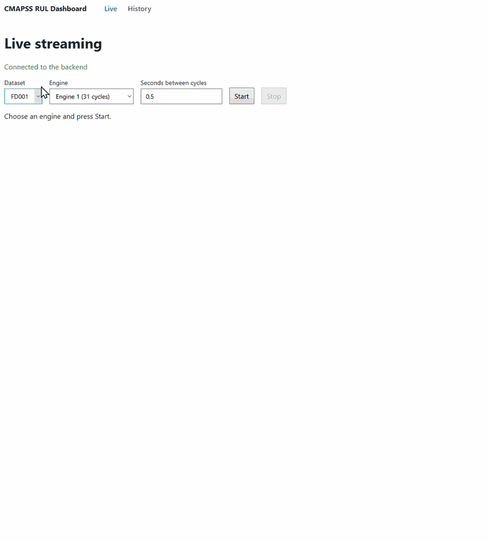
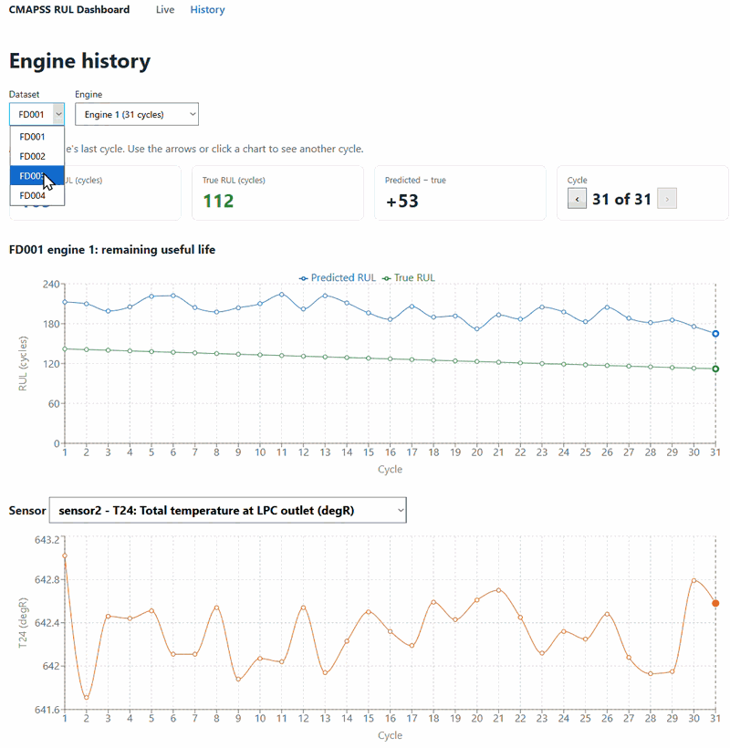
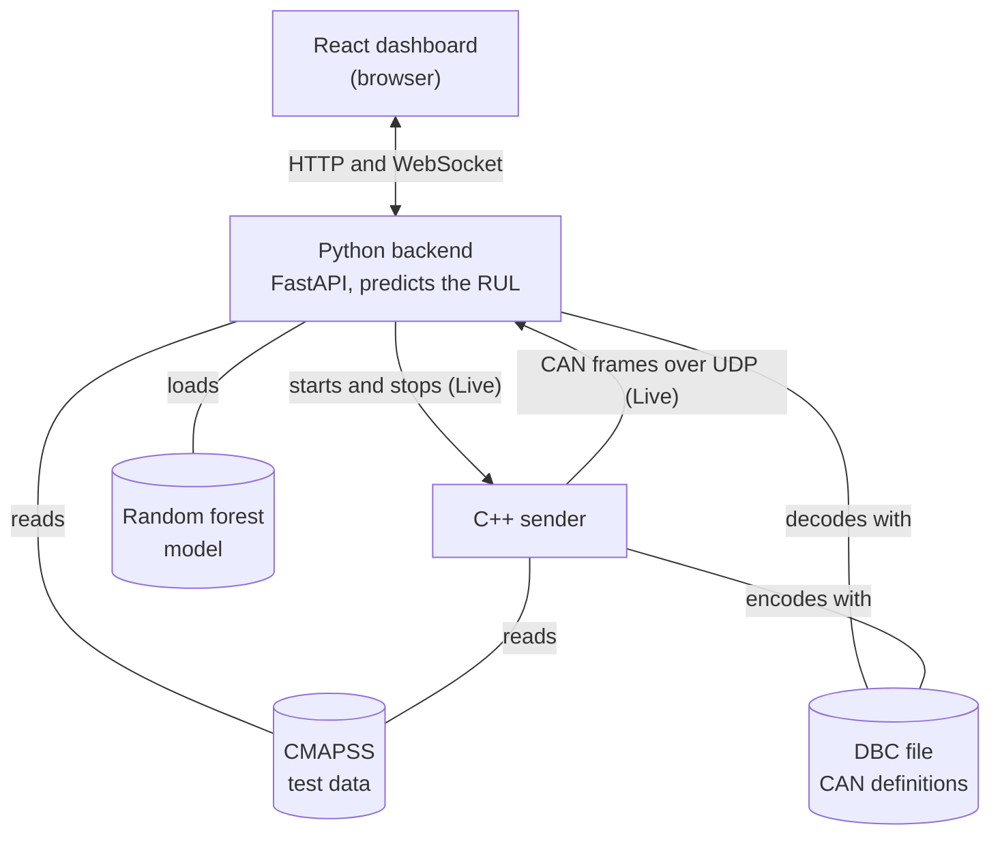
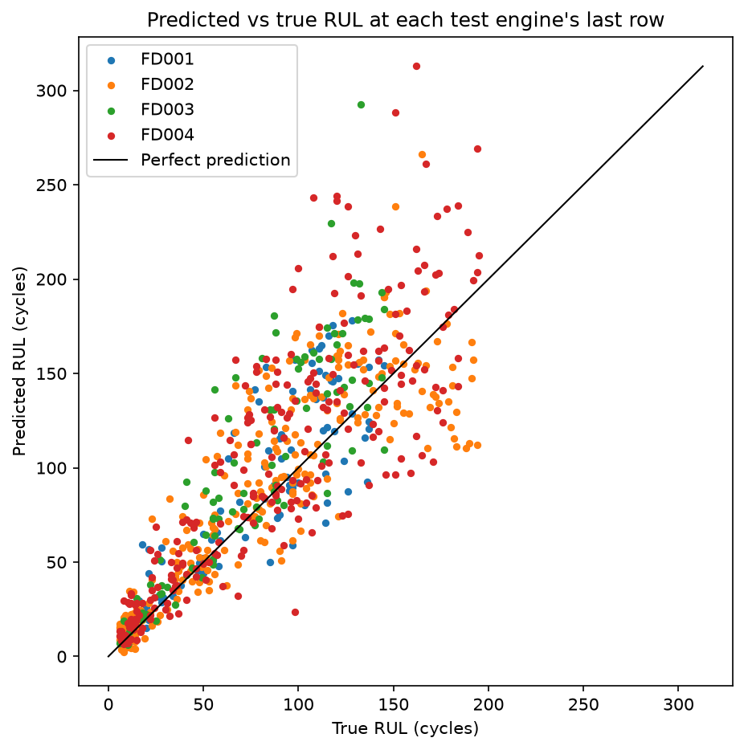

# CMAPSS RUL Dashboard

This project is an end-to-end system that predicts how many more flights, or cycles, a jet engine can make before it fails, its remaining useful life (RUL), using NASA's CMAPSS dataset of simulated turbofan engines. A C++ program replays an engine's sensor readings flight by flight, packed as CAN messages, the message format used on vehicle and machine networks, and sends them over the network via UDP. A Python backend puts the messages back together, predicts the RUL with a random forest regression model, and streams each prediction to a React dashboard, where it is plotted against the true RUL as the flights come in.


### Live page




### History page




## Architecture



When you press Start on the Live page, the React dashboard sends a start request to the Python backend over HTTP, and the Python backend launches the C++ sender for the chosen engine. The C++ sender reads that engine's test data and replays it cycle by cycle. Each cycle is packed into six CAN frames, as defined in the DBC file, and sent to the Python backend as UDP packets. The backend decodes the frames with the same DBC file, puts each cycle back together, predicts the RUL with the random forest model, and pushes the prediction to the React dashboard over a WebSocket, together with the true RUL and the sensor values. The History page skips the stream and the C++ sender. It requests a whole engine's history from the Python backend over HTTP, and the backend predicts every cycle at once from the test data it loaded when it started.

### Built with

- C++17 with CMake and Winsock, for the sender
- Python with FastAPI, scikit-learn, pandas and cantools, for the backend, the model and the protocol
- React with TypeScript, Vite and Recharts, for the dashboard
- pytest, for the tests

The design decisions, the CAN frame layout, the backend's API and the tests are described in [docs/system_design.md](docs/system_design.md).

## Results

The table below shows how far the model's predictions are from the true RUL, in cycles. MAE is the average error and RMSE gives large errors more weight. Each of the 707 test engines is scored once, at its last cycle, because that is where NASA gives the true RUL. The dashboard shows predictions for every cycle, but only each engine's last cycle counts towards these scores.

The baseline is a simple comparison that always guesses the same number, the average RUL in the training data (122.3 cycles).

| Dataset | Test engines | Model MAE | Model RMSE | Baseline MAE | Baseline RMSE |
|---|---|---|---|---|---|
| FD001 | 100 | 19.86 | 26.96 | 49.57 | 62.60 |
| FD002 | 259 | 21.40 | 29.79 | 57.33 | 67.71 |
| FD003 | 100 | 27.44 | 39.26 | 50.98 | 62.64 |
| FD004 | 248 | 28.43 | 40.24 | 54.64 | 65.21 |
| All | 707 | 24.50 | 34.84 | 54.39 | 65.43 |

The trained random forest regression model outperforms the baseline in both measurements. Over all 707 test engines, its predictions are off by 24.50 cycles on average, while always guessing the training average is off by 54.39 cycles. FD001 and FD002 are the easiest datasets, with an average error of about 20 cycles. FD003 and FD004 are the hardest, at about 28 cycles. According to NASA's documentation, these are the two datasets where an engine can have two kinds of fault instead of one.




In the plot above, each dot is one test engine at its last cycle, and the black line is a perfect prediction. The plot shows that near the end of the RUL for an engine, the model is more accurate than in earlier stages of an engine's life.

### What this means in practice

The scores above use only each engine's last cycle, as the benchmark defines it. In practice, a monitoring system could predict the RUL after every flight, like the Live page does. The table below therefore uses every cycle of every test engine, grouped by how far the engine was from failure, meaning how many cycles it had left of its RUL. A positive average means the model predicted more remaining life than there was.

| True RUL (cycles) | Cycles | Model MAE | Average predicted − true |
|---|---|---|---|
| under 25 | 1662 | 9.53 | +7.84 |
| 25-50 | 4609 | 19.56 | +16.90 |
| 50-100 | 16341 | 31.15 | +25.12 |
| 100-150 | 27033 | 35.58 | +21.57 |
| 150-200 | 26271 | 34.12 | +3.11 |
| 200 and above | 28981 | 68.37 | -56.03 |

The model is most accurate close to failure. When fewer than 25 cycles remain, it is around 10 cycles off on average, and around 20 when 25-50 cycles remain. Further from failure, the MAE grows.

The table also shows in which direction the model is wrong. Up to 150 cycles from failure, it tends to predict more remaining life than the engine has, by 8-25 cycles on average. Knowing that, a safety margin could be subtracted from its predictions before planning maintenance, so that maintenance isn't planned too late.

The tables and the plot are created by running `venv\Scripts\python -m training.evaluate_on_test`, which saves them in [results/](results/).

## Data

The data is NASA's [CMAPSS Jet Engine Simulated Data](https://data.nasa.gov/dataset/cmapss-jet-engine-simulated-data), with simulated turbofan engines in four datasets (FD001-FD004) and 21 sensors. The files in `data/` (`train_FD00x.txt`, `test_FD00x.txt`, `RUL_FD00x.txt` and `readme.txt`) are unchanged copies from NASA's `CMAPSSData.zip`.

## Requirements

- Windows
- Python 3.14
- Visual Studio 2022 with "Desktop development with C++"
- CMake, on PATH
- Node.js 24

## Setup

Run every command from the project folder. The setup steps go in this order.

**1. Install the Python packages**

```
python -m venv venv
venv\Scripts\python -m pip install -r requirements.txt
```

**2. Create the combined data files** from NASA's files in `data/`

```
venv\Scripts\python -m training.prepare_complete_training_data
venv\Scripts\python -m training.prepare_combined_test_data
```

**3. Train the model** (takes a few minutes)

The model file is about 1 GB, so it isn't in the repo.

```
venv\Scripts\python -m training.train_model
```

**4. Build the C++ sender**

```
cmake -S cpp_sender -B cpp_sender/build
cmake --build cpp_sender/build --config Release
```

**5. Install the dashboard's packages**

```
cd frontend
npm install
cd ..
```

## Run the dashboard

Start the backend in one terminal:

```
venv\Scripts\python -m uvicorn backend.server:app
```

Wait until it prints `Application startup complete.` (it loads the model first, which takes a few seconds). Then start the dashboard in a second terminal:

```
cd frontend
npm run dev
```

Open http://localhost:5173 in the browser.

- **Live**: choose a dataset, an engine and the seconds between cycles, then press Start. The backend starts the C++ sender itself, and the cycles appear one at a time. Stop ends the stream early.
- **History**: shows a whole engine at once, as soon as you choose it. It doesn't use the C++ sender, so it works even if the sender isn't built.

Stop both with Ctrl+C.

## Run without the dashboard

The listener prints each cycle's predicted RUL in the terminal. It uses the same port as the backend, so stop the backend first.

Start the listener in one terminal:

```
venv\Scripts\python -m python_listener.listener
```

Wait until it prints `Listening on 127.0.0.1:48000`. Then start the sender in a second terminal:

```
cpp_sender\build\Release\cmapss_sender.exe --dataset FD001 --unit 1
```

Sender settings:

| Setting | Meaning | Default |
|---|---|---|
| `--dataset` | FD001, FD002, FD003 or FD004 | FD001 |
| `--unit` | Engine number within the dataset | 1 |
| `--delay` | Seconds between cycles | 0.5 |
| `--data` | Path to the test data CSV | `data/combined_test_data.csv` in the project |

Stop the listener with Ctrl+C.

## Tests

Requires the backend, the listener and the C++ sender to be closed, because the tests start their own backend and use the same ports. The dashboard can keep running.

```
venv\Scripts\python -m pytest
```

The tests that need the C++ sender are skipped if it isn't built.

## Changing the protocol

After changing the protocol, regenerate the DBC file and the C code, then rebuild the C++ sender (setup step 4):

```
venv\Scripts\python -m protocol.generate_dbc
```

## Known limitations

The system runs on Windows only, and the model is left untuned. The full list is in [docs/system_design.md](docs/system_design.md#6-limitations).
