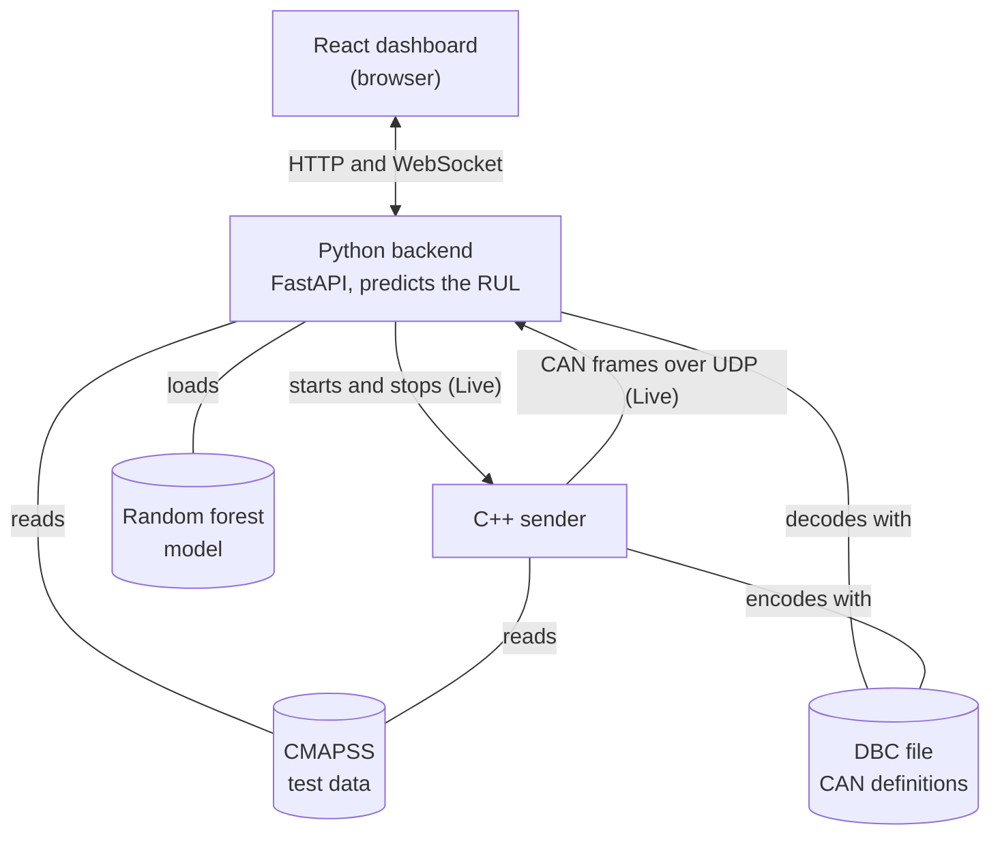

# System Design Description

## 1. Purpose and scope

This system implements a simulated engine telemetry pipeline using NASA's [CMAPSS](https://data.nasa.gov/dataset/cmapss-jet-engine-simulated-data) data, transmitting it through a simulated CAN-bus interface in C++ to a Python-based processing pipeline with a random forest regression model for RUL prediction. The predictions are shown in a React dashboard, either live as each cycle arrives or for a whole engine at once.

## 2. Architecture



The dashboard has two pages that use the system differently. On the Live page, the Python backend starts the C++ sender for one engine, the C++ sender replays the engine as CAN frames over UDP, and the Python backend decodes the frames, predicts the RUL and pushes each cycle to the page over a WebSocket. The History page skips the stream and the C++ sender. Instead, the Python backend directly takes the engine from the test data it has in memory, predicts every cycle at once and answers over HTTP.

### 2.1 C++ sender

The C++ sender, in `cpp_sender/`, provides the stream for the Live page. It reads the combined test data, keeps the rows of one engine and replays them in cycle order. Each cycle becomes six CAN frames, built with C code that cantools generates from the DBC file, and each frame is sent as one UDP packet. The sender waits the chosen delay between cycles and exits after the engine's last cycle. The History page doesn't use it.

The program is split into four files. `main.cpp` runs the program from start to end. First it reads the settings it was started with, which are the dataset, the engine, the seconds between cycles and the location of the test data file, and stops with an error if any of them is invalid. Then it gets the engine's cycles from `csv_reader.cpp`, and for each cycle it builds the six frames with `frames.cpp`, sends them to the Python backend with `udp_sender.cpp` and waits before the next cycle.

`csv_reader.cpp` reads the test data file, checks that it has every column the sender needs, keeps only the chosen engine's rows and sorts them by cycle.

`frames.cpp` turns one cycle into six CAN frames with the C code generated from the DBC file. All six frames get the same counter value, which goes from 0 to 15 and then starts over, so the Python backend can tell which frames belong to the same cycle.

`udp_sender.cpp` sends each frame as one UDP packet. It starts the Windows networking when it is created and shuts it down when it is destroyed, so the networking is closed properly even when an error stops the program.

If anything goes wrong, for example if the test data file is missing, the sender prints the error and exits with code 1. The Python backend then passes the error on to the Live page, which shows it.

### 2.2 Python backend

The Python backend, in `backend/`, is a FastAPI application. It also uses the decoding and prediction code in `python_listener/`, which the terminal listener uses too. When the backend starts, it loads the trained model, the true RUL of every test cycle, the sensor names and units from the DBC file, and the test data. The test data is used by the History page, the engine list and the check that the chosen engine exists when Start is pressed. The Live page's values never come from it, because they arrive from the C++ sender.

For the Live page, the backend starts and stops the C++ sender as a separate process and reports whether a stream is running. It receives the sender's UDP packets, decodes the CAN frames with the DBC file, puts each cycle's six frames back together, predicts the RUL, adds the true RUL and pushes the cycle to the dashboard over a WebSocket. For the History page, it predicts every cycle of one engine at once from the test data in memory and answers over HTTP. For both pages, it lists a dataset's engines with their number of cycles, and the sensors' names and units.

Inside the backend, each UDP packet from the C++ sender is received by the packet receiver (`PacketReceiver` in `server.py`), which passes it on to the row assembler (`python_listener/row_assembler.py`). The row assembler ignores packets of the wrong size or with an unknown ID, and decodes the others with the DBC file. Decoding can leave tiny errors in the decimals, so the row assembler rounds each value to as many decimals as it has in the test data. The row assembler collects frames until it has all six with the same counter, and if a new counter arrives before that, the unfinished cycle is dropped. When a cycle is complete, the packet receiver predicts the RUL, looks up the true RUL and puts the cycle in a queue. A separate task takes the cycles out of the queue, in order, and sends them to the dashboard over the WebSocket. Both run in FastAPI's asyncio event loop, which lets the backend keep receiving packets while it is sending earlier cycles. Each Start gives the row assembler a fresh start, so a half-finished cycle from an earlier stream can't mix with the new one.

FastAPI handles the HTTP requests in separate threads, so several requests can run at the same time. Because of that, Start, Stop and the Live page's status checks, which it makes every second, share a lock, so only one of them uses the C++ sender at a time. Without the lock, two Start requests at the same moment could launch two senders.

If the C++ sender stops because of an error, for example a missing test data file, the backend passes the sender's error message on to the Live page. Pressing Stop on the Live page is not treated as an error. If there is a sender running when the backend is shut down, the backend stops it first.

### 2.3 React dashboard

The React dashboard, in `frontend/`, has two pages that show the same things. Both have a chart of the predicted and true RUL, a chart of one sensor chosen from a dropdown, and cards that show one cycle's predicted RUL, true RUL, the difference between them and which cycle is currently selected.

On the Live page, you choose a dataset, an engine and the seconds between cycles, then press Start. The charts grow by one cycle at a time as the cycles arrive, and the cards show the newest cycle. When the stream has finished or been stopped, you can go through the received cycles the same way as on the History page.

The History page shows a whole engine at once, as soon as it is chosen, and the cards start at the engine's last cycle. Clicking the arrows on the cycle card, or a specific cycle in one of the charts, selects that cycle and displays the cards for it.

All calls to the Python backend go through `api.ts`, which also turns the backend's error answers into readable messages. The pages load their data with custom hooks. `useEngines.ts` and `useSensorLabels.ts` fetch the engine list for the chosen dataset and the sensor names, which both pages use. `useEngineHistory.ts` fetches the chosen engine's cycles for the History page, and ignores a late answer if the user has already switched to another engine. `useCycleSelection.ts` is used by both pages and keeps track of which cycle the cards show and the charts mark. The charts, the dropdowns and the cards are shared components in `components/`.

The Live page connects to the backend's WebSocket when it opens. When a cycle arrives, it is added to the charts if it is the next cycle of the same engine. If it comes from another engine, the old cycles are cleared and the charts start again from the new one. The WebSocket only carries cycles, so the page also asks the backend every second whether a stream is running. That is how it finds out that a stream has ended or failed. When you press Start, the old charts are only cleared once the backend has accepted the request, so a refused Start keeps them.

### 2.4 Offline scripts

These are run once, before the system is used, and neither page runs them:

- `training/`: prepares the training and test data, trains the model and scores it on the test engines
- `protocol/`: designs every signal's range and resolution from the training data, writes the DBC file and generates the C code for the sender

## 3. Interfaces

### 3.1 CAN frames

The Live page's stream sends each cycle as six classic CAN frames of 8 bytes. The History page doesn't use them. Every frame starts with a 4-bit counter in bits 0-3, which counts 0-15 and then starts over. All six frames of one cycle carry the same counter value.

| ID | Name | Contents | Bits used |
|---|---|---|---|
| 0x100 | ENGINE_INFO | counter, dataset, engine number, cycle, settings 1-3 | 64 of 64 |
| 0x101 | SENSORS_1 | counter, sensors 1-4 | 64 of 64 |
| 0x102 | SENSORS_2 | counter, sensors 5-8 | 58 of 64 |
| 0x103 | SENSORS_3 | counter, sensors 9-12 | 55 of 64 |
| 0x104 | SENSORS_4 | counter, sensors 13-17 | 61 of 64 |
| 0x105 | SENSORS_5 | counter, sensors 18-21 | 55 of 64 |

All signals are unsigned, in Intel byte order. A value is stored as the whole number raw = round((value − start) / step), where each signal's start and step are defined in `protocol/cmapss_engine.dbc`.

#### Reading the DBC file

Each sensor value is converted to a whole number before being sent over the "CAN bus" (UDP). The whole numbers needed for the sensor values in this dataset need fewer bits than a float, which needs 32, because each sensor value is only counted as steps above its start value and not as the full sensor reading.

Looking at a message and one of its signals in the DBC file:

```
BO_ 257 SENSORS_1: 8 ENGINE_REPLAY
SG_ sensor1 : 4|14@1+ (0.01,437.63) [437.63|601.46] "degR" RUL_LISTENER
```

* `257` is the message ID written in normal numbers. It is 0x101. Our messages start at 0x100.
* `SENSORS_1` is the name of the message
* `8` means the complete message `SENSORS_1` is 8 bytes long
* `ENGINE_REPLAY` is who sends this message. It is the C++ sender.

* `SG_ sensor1` is the value for sensor 1 in the dataset
* `4` means the value for sensor 1 starts at bit 4 of this message
* `14` means this part (sensor 1) of the message takes 14 bits
* `@1` means the lowest bits (least significant byte) go first (little endian)
* `+` means the whole number sent is never negative
* `(0.01,437.63)` 0.01 is the scale/factor (step value) and 437.63 is the offset (start value). They come from the DBC formula `physical = raw × factor + offset` at the receiver/decoder, and `raw = (physical − offset) / factor` at the sender/encoder.
* `[437.63|601.46]` is the lowest and highest allowed physical value, the range. It's informational, so the DBC file itself doesn't stop values outside it. In this project, cantools in Python refuses them, but the C++ sender doesn't check them.
* `degR` is a label telling the unit (degrees Rankine in this case)
* `RUL_LISTENER` is a label telling who receives the message (the Python backend)

#### Example: 518.67 sent over

- The sender uses the formula `raw = round((physical − offset) / factor)` => `raw = round((518.67 - 437.63) / 0.01) = round(81.04 / 0.01) = round(8104) = 8104`. Why it rounds is explained under the design decisions.
- 8104 written in 14 bits: `01 1111 1010 1000`
- Lowest bits go first, so we get:
    - bits 4-7, get sensor1's lowest 4 bits: `1000`
    - bits 8-11, get sensor1's next 4 lowest bits: `1010`
    - bits 12-15, get sensor1's next 4 bits: `1111`
    - bits 16-17, get sensor1's top 2 bits: `01`
- The receiver gets these 14 bits, starting at bit 4, lowest bits first, which is `01 1111 1010 1000 = 8104`, and calculates `physical = raw * factor + offset` => `physical = 8104 * 0.01 + 437.63 = 518.67`, which is the same value the sender started with.

### 3.2 UDP packets

Each frame of the Live page's stream is one 12-byte UDP packet to 127.0.0.1, port 48000. The packet starts with the frame ID as a 4-byte little-endian number, followed by the frame's 8 data bytes.

A frame is the CAN message itself (ID + 8 data bytes). A packet is the UDP "envelope" the frame travels in over the network. So one packet is one frame, which is the same as one CAN message created from the DBC description of a message, and one cycle is sent as 6 UDP packets.

The 8-byte limit is there because we want to simulate an actual CAN bus, even though UDP could send a lot more. Each CAN message comes with an ID. On a real CAN bus, the ID is not part of the 8 bytes but is sent beside the message, so we just add it to the beginning of our UDP packet.

### 3.3 Backend API

The React dashboard talks to the Python backend through these HTTP requests and one WebSocket. Values like `FD001` and `1` are examples.

| Request | Sent by the dashboard | Answer |
|---|---|---|
| `GET /api/history?dataset=FD001&unit=1` | History page, when it opens and when an engine is chosen | Every cycle of the engine, with the predicted and the true RUL |
| `GET /api/engines?dataset=FD001` | Both pages, when they open and when the dataset changes | Every engine in the dataset, with its number of cycles |
| `GET /api/sensors` | Both pages, when they open | Each sensor's short name, description and unit from the DBC file |
| `POST /api/start` with `{"dataset": "FD001", "unit": 1, "delay": 0.5}` | Live page, when Start is pressed | Starts the stream for one engine. 409 if a stream is already running |
| `POST /api/stop` | Live page, when Stop is pressed | Stops the stream |
| `GET /api/status` | Live page, every second | Whether the stream is running, or the C++ sender's error if it failed |

The cycles of the Live page's stream come over the WebSocket at `/api/live` instead. The Live page connects to it when the page opens, and the connection stays open as long as the page is open. The backend sends one message per cycle as soon as the cycle is ready, with the dataset, engine, cycle, predicted and true RUL, settings and sensors. The page only listens and never sends anything over it.

History rows and live messages have the same format, built by the same function, so both pages can use the same charts.

## 4. Design decisions
 

**CAN frames over UDP instead of a real CAN bus.** The Live page's stream sends CAN frames over UDP. A real or virtual CAN bus would need extra hardware or drivers. The frames themselves are the same as on a real CAN bus, with the same IDs, 8 data bytes and DBC file, and only the way they are sent is different. All the UDP code is in `udp_sender.cpp`, so that is the only file that would need to be replaced to use a real CAN bus.

**Encoding and decoding come from the DBC file, not hand-written code.** For the Live page's stream, the C++ sender encodes with C code that cantools generates from the DBC file, and the Python backend decodes with cantools reading the same file. The alternative, writing the bit packing by hand in both C++ and Python, would make it easy for the two sides to disagree. The DBC file also holds each sensor's real name and unit, which the dashboard shows.

**Signal ranges come from the training data, with 10% spare room.** This decides which values the Live page's stream can carry. Only the training data is used, because in a real system the protocol has to be designed before any data from new engines exists, and the test engines play the role of those new engines. Each signal's range is the lowest to the highest training value, widened by 10% of the range at both ends, because unseen engines could go slightly outside the training values. `protocol/compute_signal_ranges.py` checks that 10% is enough. It picks 20% of the training engines at random, pretends they are new, and measures how far their values go outside the range of the other 80%. This is repeated 20 times, with a different random 20% each time. The worst case was 1.03% of the range, so 10% leaves more than enough room.

**Each signal uses the largest step that still keeps every value exact.** sensor2 has two decimals in the data, so it is stored in steps of 0.01, and its values come back exactly as they were sent. A larger step needs fewer bits, so each signal gets the largest step that still keeps all its values exact, and all 24 settings and sensors fit in 312 bits. Because nothing is lost in the frames, the Live page shows exactly the same values as the History page, which gets them straight from the test data.

**The sender rounds instead of cutting off decimals.** To put a value in a frame, the sender turns it into a whole number with `(value − start) / step`, as in section 3.1. For example, sensor1 = 518.67 gives `(518.67 - 437.63) / 0.01`, which is mathematically exactly `8104`. A computer can store whole numbers like `8104` exactly, but most decimal numbers only approximately. Here, `518.67` may be stored as `518.66999999...` and `0.01` as `0.01000000...02`. Because the calculation uses these slightly-off decimal numbers, the result is `8103.999999999996` instead of `8104`.

Turning that into a whole number:

- Cutting off the decimals gives `8103` => the receiver gets `518.66` (wrong)
- Rounding gives `8104` => the receiver gets `518.67` (right)

How to turn it into a whole number is up to the tool. Cantools rounds automatically when it encodes values in Python. But when cantools generates C code for the C++ sender, the encode functions it writes cut off the decimals instead, unless you ask for rounding. So in `generate_dbc.py`, we run the C code generator with the `--use-round` option, which makes it use rounding in every encode function.

**A counter ties each cycle's six frames together.** Since the Live page's stream splits each cycle into six frames, we need to keep track of which frames together form one cycle. For that we use a counter and have made the counter a part of the actual 8 bytes of the CAN frame itself. That way, when the backend gets a frame with a new counter, it knows a new cycle has started. Also, if a new counter shows up before the current cycle has been finished, the backend knows that cycle is incomplete and throws it away instead of mixing it with the next one.

**The true RUL is kept in its own file.** The file the sender reads has no RUL column, so the true RUL can never end up in the Live page's stream or in the model's input. It is only shown next to the prediction in the dashboard and used to score the model.

**The training and validation data are split by whole engines.** When the model is trained, 80% of the training engines are used to train it and the other 20% to check it, and all cycles of one engine end up on the same side. Splitting the cycles at random instead would put cycles of the same engine on both sides. Cycles next to each other are almost the same, so the model would be checked on data it has nearly seen already, and the validation score would look better than it really is.

**The model is scored on each test engine's last cycle.** NASA gives the true RUL of each test engine only after its last cycle, so the score uses that cycle, for 707 test engines in total. The dashboard shows a prediction for every cycle, but those don't count towards the score. To show what the score is worth, `training/evaluate_on_test.py` also scores a baseline that always guesses the average RUL in the training data, on the same cycles. Both scores are shown in the README's results.

**The backend starts and stops the C++ sender itself.** The alternative would be to start the sender by hand in a terminal, as when it is run without the dashboard. Instead, Start and Stop on the Live page ask the backend, and the backend starts or stops the sender. Because the backend is the only one that starts it, it always knows whether a stream is running and for which engine. That lets it refuse a second Start while a stream is running, show the sender's errors on the Live page, and stop the sender when the backend shuts down.


## 5. Testing

The tests are written in Python and run with `pytest`. There are 29 tests in four files.

- Round-trip testing the DBC file: CMAPSS data is encoded according to the DBC specification with `cantools` and decoded again. The resulting values are then compared against the original data.
- Boundary testing: Every signal is encoded with `cantools` at the lowest and highest value allowed by the DBC specification, and decoded again. The resulting values are then compared against the original values. Real data never reaches these values, so this covers what the round-trip test can't.
- C++ sender integration testing: The C++ sender is executed with selected parts (FD001 engine 1, FD004 engine 7) of the CMAPSS datasets and the packets it sends are compared byte for byte with the same part encoded with Python `cantools`. A further test checks that the sender reports a clear error for an empty data file.
- Row assembly: packets are fed to the row assembler, which rebuilds the Live page's cycles, in order, in reverse order, with one frame missing and with packets that don't belong to the protocol. Decoded values must equal the CSV values exactly.
- Backend API: the backend is started as a real program and every endpoint both pages use is called like the dashboard calls it, including the error answers, a double Start, a failing sender and a stream that ends by itself.
- Live against History: one engine is streamed through the Live page's whole chain, from the C++ sender over UDP to the decoding, the prediction and the WebSocket. Every live row must exactly equal the same row from the History page's request.

## 6. Limitations

- Windows only, and the sender and backend run on the same computer.
- The Live page can stream one engine at a time.
- The model is left untuned.
- The C++ sender does not check that values are inside the DBC ranges. The test data always is, but other data could be sent wrongly in the Live page's stream without a warning.
